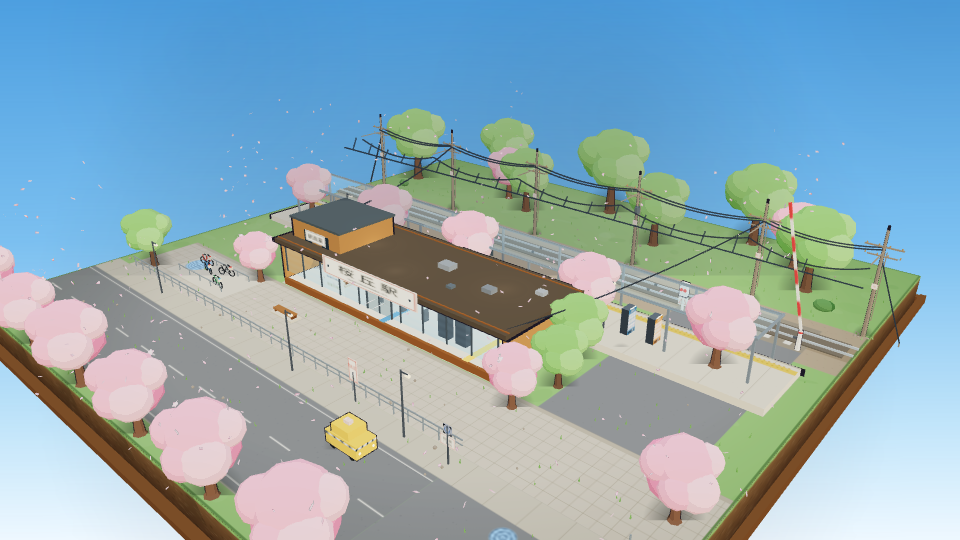

# 樱花车站 · 日式微缩场景（Sakura Station Diorama）

一个单文件的日式火车站微缩沙盘：三渲二卡通渲染、白昼樱花、通勤电车进站、可自由拖拽旋转缩放的"沙盒"景观模型。无任何 UI 界面元素。

> 本项目由本地部署的 **Qwen3.8-27B** 生成，并完成浏览器端功能测试（列车运行、裁切、动效、渲染验证）。

> **▶ 直接打开沙盘（免下载）**：[givfei5-hash.github.io/sakura-station-diorama](https://givfei5-hash.github.io/sakura-station-diorama/)

## 怎么玩

直接点上面的链接即可在线打开（GitHub Pages），或用浏览器打开仓库里的 `index.html`（需联网，three.js 走 jsDelivr CDN）：

- 左键拖拽：旋转视角
- 滚轮：缩放
- 右键拖拽：平移
- 默认机位为整个底座的全景第三视角，像看一个摆在桌上的模型

## 场景内容

- **正方形底座**：土截面 + 木框，悬浮在天空中
- **站房**：暖木立面 + 大面积玻璃，内部有检票口（指示灯轮闪）、自动售票机、候车长椅、小卖部（货架/饮料柜/杂志架/便当台）、站员室、线路图、时刻表、墙钟、地面导视
- **站台**：雨棚、盲道、长椅、垃圾桶、两台自动贩卖机、吊挂时钟、方向标
- **铁轨与列车**：银蓝色两节通勤电车，车头带前照灯，车窗映着天空与樱花，受电弓贴住接触网；按固定间隔从西侧驶入、进站减速、通过再加速；超出底座的部分被裁切，列车只在沙盘内出现
- **电线杆**：爬梯、绝缘子、横担、变压器、拉线、贴纸；接触网 + 吊弦 + 引下电线，微风轻晃，列车驶过会震动
- **道口**：红白栏杆 + 交替闪红灯信号，列车临近自动落下
- **站前**：小广场、出租车、自行车停车处、护栏、路牌
- **树**：道路樱花行道树（成排）、站台与绿地散植樱花/常绿树、后排疏林
- **动效**：樱花花瓣持续飘落（420 片）、落水泛涟漪、被列车气流卷起；站台时钟秒针走动；云影缓慢扫过地面；小鸟偶尔落在电线上停一阵再飞走；列车驶过时玻璃与积水掠过移动倒影

## 技术

- 单文件 HTML，无构建、无依赖安装
- [three.js r160](https://cdn.jsdelivr.net/npm/three@0.160.0)（CDN importmap）
- 三渲二：`MeshToonMaterial` + 4 级渐变 + 反壳描边
- 列车裁切：`renderer.localClippingEnabled` + 两个本地裁切平面
- 花瓣：`InstancedMesh`（420 实例）
- 自定义 ShaderMaterial：玻璃列车倒影扫过、积水涟漪/震碎

## 许可

随意使用、修改、二创。
